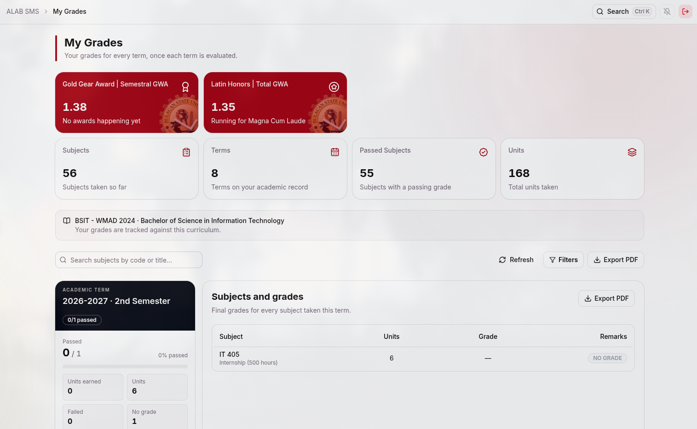
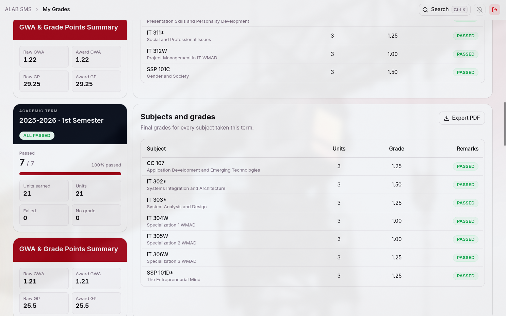
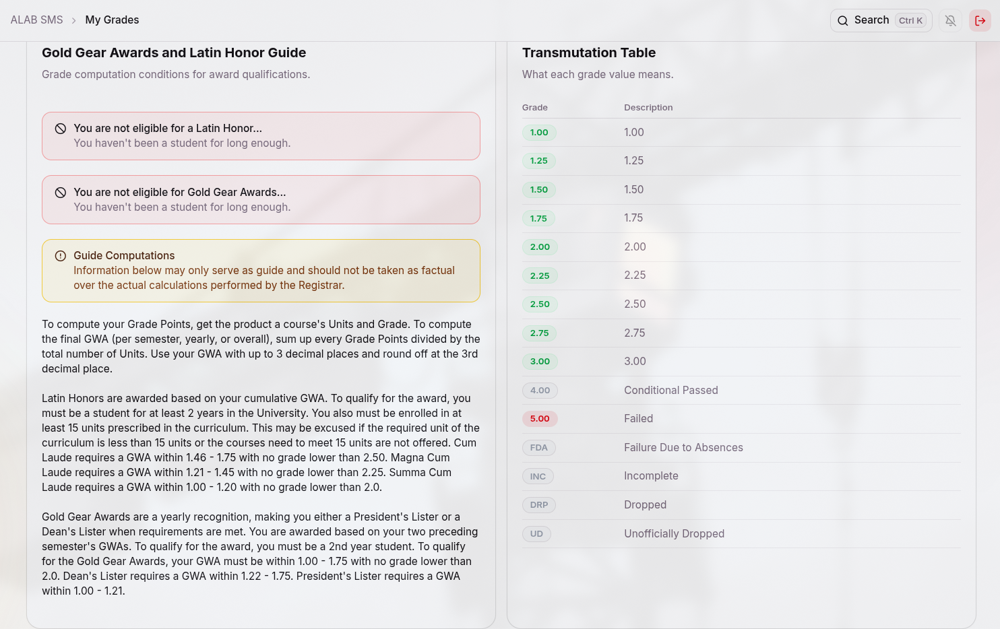

# gwa-at-a-glance

An extension for computing and summarizing your GWAs for convenience and ease of viewing! This extension is built for the Bulacan State University School Management System and its lacking feature of computed GWAs for its students. With the extension, students can easily view their semesters' computed GWAs and eligibility for the Gold Gear Awards and Latin Honors.

## Why

I saw a post from a fellow BulSUan who created a whole-ass website just to compute GWAs. It seemed overkill for me and to top it off, it only allows manual input of grades. This extension removes the need to go to a random site and manually input your data so you can view your GWAs right in the school's portal!

## How it works

The extension only extracts data from the text **available** in the page and perform necessary computations with it! No data being sent anywhere, all temporary. This does also mean that it is entirely dependent on the reliability and integrity of the system's data from the backend. Right now, some courses are missing (PE for the 1st year 1st semester) so it produces off results.

## Screenshots

## Installation

> [!IMPORTANT]
>
> Mozilla has not verified the extension yet so you won't be able to install the extension for the time being

> [!NOTE]
>
> The whole script can also be installed through a greasy fork userscript. Just install your favorite manager and install the file!

### Download as extension

1. Download the extension file

Browse the Releases section and go to the latest release and download the respective extension package for your browser.

2. Install extension to your browser

Drag and drop the downloaded extension to your browser (or the extensions page of your browser) and enjoy!

### Download as userscript

The application can also be used as a Greasy Fork userscript. To use, install your favorite greasy fork manager and install the script through [here](https://greasyfork.org/en/scripts/606088-gwa-at-a-glance)!
